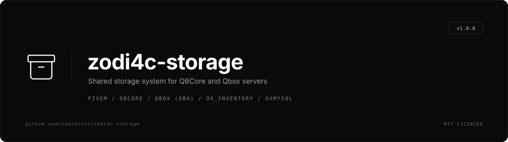
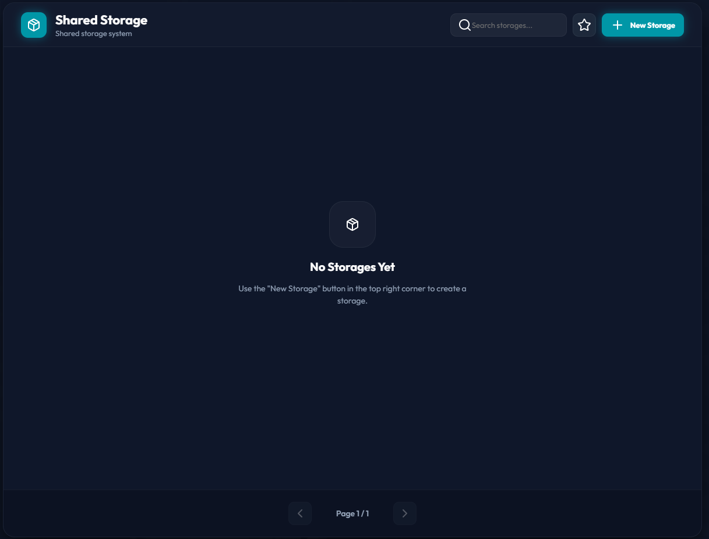
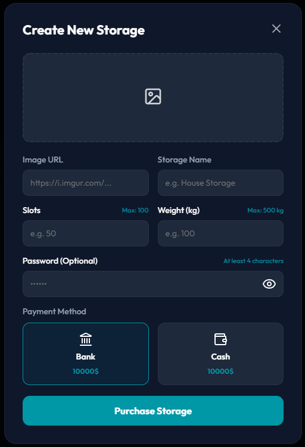
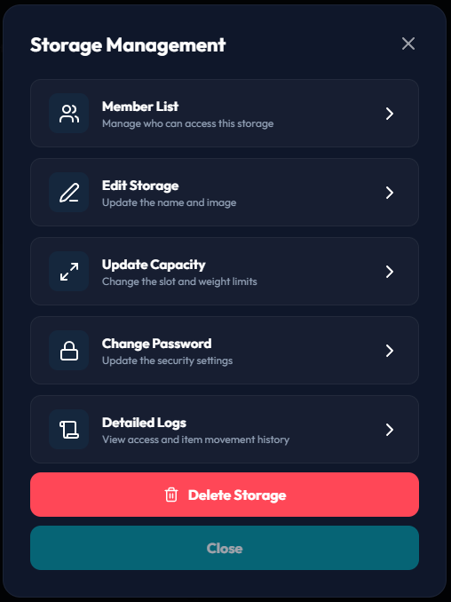

<div align="center">



# zodi4c-storage

**QBCore ve Qbox (QBX) için paylaşımlı depo sistemi · Shared storage system for QBCore and Qbox (QBX)**

[](CHANGELOG.md)
[](LICENSE)
[](https://github.com/qbcore-framework)
[](https://github.com/Qbox-project)
[](https://github.com/overextended/ox_inventory)
[](https://github.com/zodi4ctvn/zodi4c-storage)

[Türkçe](#türkçe) · [English](#english) · [Kurulum](docs/installation.md) · [Yapılandırma](docs/configuration.md)

</div>

---

## Türkçe

### Genel Bakış

`zodi4c-storage`, oyuncuların kendi depolarını oluşturmasına, arkadaşlarıyla paylaşmasına ve
ox_inventory üzerinden eşya saklamasına olanak tanıyan, tamamen NUI tabanlı bir depo
kaynağıdır. **QBCore** (`qb-core`) ve **Qbox / QBX** (`qbx_core`) sunucularında çalışır;
Qbox tarafında ek bir uyumluluk kaynağı gerekmez. Depo bilgileri veritabanında tutulur,
eşyalar ise ox_inventory stash'leri içinde saklanır.

Depo oluştururken slot sayısı, ağırlık kapasitesi, isim, görsel ve isteğe bağlı şifre
belirlenir. Şifreli depolar için hatalı deneme sayacı ve geçici kilit devreye girer.

### Öne Çıkan Özellikler

- **QBCore ve Qbox uyumlu** — Qbox/QBX sunucularında `qbx_core` içindeki `qb-core` köprüsü
  üzerinden, kod değişikliği olmadan çalışır.
- **Paylaşımlı depolar** — sahip, depoyu şifre ile veya üye listesiyle paylaşabilir.
- **Tam NUI arayüzü** — arama, favoriler, sayfalama, görsel önizleme ve yönetim panelleri.
- **Çift dil desteği** — arayüz ve bildirimler için Türkçe (`tr`) ve İngilizce (`en`).
- **Kapasite yönetimi** — slot ve ağırlık limitleri hem istemci hem sunucu tarafında doğrulanır.
- **Şifre koruması** — minimum/azami uzunluk, hatalı deneme limiti ve geçici kilit.
- **Detaylı loglar** — kim, ne zaman, neyi aldı veya depoya koydu; son 150 kayıt görüntülenir.
- **Güvenli render** — depo adı, üye adı ve log detayları NUI'da HTML olarak kaçırılır (XSS koruması).
- **Üyelik yönetimi** — üye atma, depodan ayrılma ve silme öncesi boşaltma zorunluluğu.
- **Performans** — yakınlık kontrolleri mesafeye göre uyarlanmış uyku süreleriyle çalışır.

### Ekran Görüntüleri

<p align="center">
  
</p>

<p align="center"><em>Ana menü — depo listesi, arama, favoriler ve sayfalama.</em></p>

<p align="center">
  
</p>

<p align="center"><em>Depo oluşturma — slot, ağırlık, isim, görsel linki, isteğe bağlı şifre ve bank/cash ödeme seçimi.</em></p>

<p align="center">
  
</p>

<p align="center"><em>Depo yönetimi — üye listesi, kapasite güncelleme, şifre değiştirme ve hareket logları.</em></p>

### Gereksinimler

| Bileşen | Sürüm / Not |
| --- | --- |
| FiveM | Güncel sunucu artefaktı (`cerulean`) |
| [QBCore](https://github.com/qbcore-framework/qb-core) | `qb-core` |
| [Qbox (QBX)](https://github.com/Qbox-project/qbx_core) | Alternatif çekirdek — `qbx_core` (`qb-core` köprüsü ile) |
| [ox_inventory](https://github.com/overextended/ox_inventory) | Stash ve hook desteği için güncel sürüm |
| [oxmysql](https://github.com/overextended/oxmysql) | Veritabanı bağlantısı |
| MySQL / MariaDB | InnoDB, `utf8mb4` |

> Sunucuda `qb-core` (Qbox'ta `qbx_core`), `ox_inventory` ve `oxmysql` kaynaklarının
> `zodi4c-storage`'dan önce başlatıldığından emin olun.
>
> **Qbox / QBX kullanıyorsanız:** `qbx_core` kendi içinde `provide 'qb-core'` köprüsünü taşır,
> bu yüzden `exports['qb-core']:GetCoreObject()`, `QBCore.Functions.*` ve para fonksiyonları ek
> kurulum olmadan çalışır. `qb-core` klasörünü **kurmak zorunda değilsiniz, kurmayın**;
> `server.cfg` içinde `ensure qbx_core` yeterlidir. Köprü varsayılan olarak açıktır
> (`qbx:enablebridge`); kapatılmışsa `GetCoreObject` bulunamaz.

### Hızlı Kurulum

1. Klasörü `resources/[zodi4c]/zodi4c-storage` altına kopyalayın.
2. `sql/zodi4c-storage.sql` dosyasını veritabanınıza aktarın.
3. `server.cfg` dosyasına `ensure zodi4c-storage` satırını ekleyin.
4. Gerekirse `config.lua` içindeki NPC konumunu ve fiyatları düzenleyin.
5. Sunucuyu yeniden başlatın.

Ayrıntılı adımlar için [docs/installation.md](docs/installation.md) dosyasına bakın.

### Yapılandırma Özeti

| Ayar | Varsayılan | Açıklama |
| --- | --- | --- |
| `Config.Locale` | `'tr'` | Arayüz dili: `tr` veya `en` |
| `Config.BlurLevel` | `0` | Menü açıkken arka plan bulanıklığı (`0` kapalı) |
| `Config.NPC.coords` | `vector4` | Depo görevlisinin konumu |
| `Config.Pricing.bank/cash` | `10000` | Depo oluşturma ücreti |
| `Config.Limits.maxSlots` | `100` | Maksimum slot sayısı |
| `Config.Limits.maxWeight` | `500000` | Maksimum ağırlık (gram) |
| `Config.Limits.maxStoragesPerPlayer` | `10` | Oyuncu başına depo limiti |
| `Config.Security.maxLoginAttempts` | `3` | Hatalı şifre deneme limiti |
| `Config.Security.lockoutDuration` | `300` | Kilit süresi (saniye) |
| `Config.Features.*` | `true` | Ayrılma, şifre kaldırma, kapasite güncelleme |

Tüm seçenekler ve örnekler: [docs/configuration.md](docs/configuration.md).

### Klasör Yapısı

```text
zodi4c-storage/
├── client/main.lua        # NPC, etkileşim, NUI köprüsü ve stash açma
├── server/main.lua        # Veritabanı, doğrulama, loglar ve yetkilendirme
├── shared/locale.lua      # Locale birleştirme ve L() yardımcısı
├── locales/tr.lua         # Türkçe metinler
├── locales/en.lua         # İngilizce metinler
├── config.lua             # Tüm ayarlar
├── fxmanifest.lua         # Kaynak tanımı
├── html/                  # NUI (index.html, style.css, script.js, assets)
├── sql/                   # Veritabanı şeması
└── docs/                  # Kurulum, yapılandırma, veritabanı, olaylar, sorun giderme
```

### Dokümanlar

| Döküman | İçerik |
| --- | --- |
| [docs/installation.md](docs/installation.md) | Adım adım kurulum ve ilk çalıştırma |
| [docs/configuration.md](docs/configuration.md) | Tüm ayarlar ve örnekler |
| [docs/database.md](docs/database.md) | Tablolar, view'lar ve SQL referansı |
| [docs/events.md](docs/events.md) | Event'ler, callback'ler ve NUI mesajları |
| [docs/troubleshooting.md](docs/troubleshooting.md) | Sık karşılaşılan sorunlar ve çözümleri |
| [CHANGELOG.md](CHANGELOG.md) | Sürüm geçmişi |

### Güvenlik Notu

Depo şifreleri veritabanında **küçük harfe normalize edilerek** saklanır; kriptografik olarak
hash'lenmez. Bu, mevcut kurulumlarla uyumluluk ve oyun içi klavyede kolay giriş için tercih
edilmiştir. Yüksek güvenlik gerektiren sunucularda bcrypt/argon2 tabanlı hash'e geçiş
planlanmaktadır; katkı sağlamak için [CONTRIBUTING.md](CONTRIBUTING.md) dosyasına bakın.

Şifresi olmayan depolar, depo listesini gören **her oyuncu tarafından** açılabilir. Özel
depolar için mutlaka şifre kullanın.

Veritabanı erişimi olan herkes bu şifreleri okuyabilir. Bu nedenle depo şifrelerini
oyuncuların başka platformlarda kullandığı şifrelerle aynı yapmamaları önerilir.

### Katkı ve Lisans

Katkılar memnuniyetle karşılanır. Lütfen [CONTRIBUTING.md](CONTRIBUTING.md) ve
[CODE_OF_CONDUCT.md](CODE_OF_CONDUCT.md) dosyalarını okuyun. Güvenlik açıkları için
[SECURITY.md](SECURITY.md) sürecini izleyin.

Bu proje [Custom Non-Commercial Attribution License](LICENSE) ile lisanslanmıştır. Copyright © 2026 [Zodi4c](https://github.com/zodi4ctvn). Ticari olmayan kullanım için ücretsizdir; yazar atfının ve kaynak adının korunması zorunludur.

---

## English

### Overview

`zodi4c-storage` is a fully NUI-based storage resource that lets players create their own
storages, share them with friends, and store items through ox_inventory. It runs on both
**QBCore** (`qb-core`) and **Qbox / QBX** (`qbx_core`) servers; on Qbox no extra compatibility
resource is required. Storage metadata is kept in the database, while the items themselves
live inside ox_inventory stashes.

Each storage has its own slot count, weight capacity, name, image and optional password.
Password-protected storages use a failed-attempt counter with a temporary lockout.

### Features

- **QBCore and Qbox ready** — runs on Qbox/QBX servers through the `qb-core` bridge inside
  `qbx_core`, with no code changes.
- **Shared storages** — owners can share by password or by adding members.
- **Full NUI interface** — search, favorites, pagination, image preview and management panels.
- **Bilingual UI** — Turkish (`tr`) and English (`en`) for both interface and notifications.
- **Capacity management** — slot and weight limits validated on the client and the server.
- **Password protection** — min/max length, failed-attempt limit and temporary lockout.
- **Detailed logs** — who took or stored what and when; the latest 150 entries are shown.
- **Safe rendering** — storage names, member names and log details are HTML-escaped (XSS safe).
- **Membership management** — kick, leave, and a mandatory empty-before-delete rule.
- **Performance-aware** — proximity loops adapt their sleep time to the player's distance.

### Screenshots

<p align="center">
  
</p>

<p align="center"><em>Main menu — storage list, search, favorites and pagination.</em></p>

<p align="center">
  
</p>

<p align="center"><em>Create storage — slots, weight, name, image link, optional password and bank/cash payment.</em></p>

<p align="center">
  
</p>

<p align="center"><em>Storage management — member list, capacity updates, password changes and activity logs.</em></p>

### Requirements

| Component | Version / Note |
| --- | --- |
| FiveM | Current server artifact (`cerulean`) |
| [QBCore](https://github.com/qbcore-framework/qb-core) | `qb-core` |
| [Qbox (QBX)](https://github.com/Qbox-project/qbx_core) | Alternative core — `qbx_core` (via the `qb-core` bridge) |
| [ox_inventory](https://github.com/overextended/ox_inventory) | Recent version with stash + hook support |
| [oxmysql](https://github.com/overextended/oxmysql) | Database layer |
| MySQL / MariaDB | InnoDB, `utf8mb4` |

> Make sure `qb-core` (`qbx_core` on Qbox), `ox_inventory` and `oxmysql` start before
> `zodi4c-storage`.
>
> **Using Qbox / QBX?** `qbx_core` ships a `provide 'qb-core'` bridge, so
> `exports['qb-core']:GetCoreObject()`, `QBCore.Functions.*` and the money functions work
> without extra setup. Do **not** install the `qb-core` folder; `ensure qbx_core` in
> `server.cfg` is enough. The bridge is enabled by default (`qbx:enablebridge`); when it is
> disabled, `GetCoreObject` cannot be resolved.

### Quick Start

1. Copy the folder to `resources/[zodi4c]/zodi4c-storage`.
2. Import `sql/zodi4c-storage.sql` into your database.
3. Add `ensure zodi4c-storage` to your `server.cfg`.
4. Adjust the NPC location and prices in `config.lua` if needed.
5. Restart the server.

See [docs/installation.md](docs/installation.md) for the full walkthrough.

### Configuration Summary

| Setting | Default | Description |
| --- | --- | --- |
| `Config.Locale` | `'tr'` | Interface language: `tr` or `en` |
| `Config.BlurLevel` | `0` | Background blur while the menu is open (`0` = off) |
| `Config.NPC.coords` | `vector4` | Storage clerk position |
| `Config.Pricing.bank/cash` | `10000` | One-time storage creation price |
| `Config.Limits.maxSlots` | `100` | Maximum slot count |
| `Config.Limits.maxWeight` | `500000` | Maximum weight (grams) |
| `Config.Limits.maxStoragesPerPlayer` | `10` | Storages per player |
| `Config.Security.maxLoginAttempts` | `3` | Failed password attempts before lockout |
| `Config.Security.lockoutDuration` | `300` | Lockout duration (seconds) |
| `Config.Features.*` | `true` | Leaving, password removal, capacity updates |

All options and examples: [docs/configuration.md](docs/configuration.md).

### Folder Structure

```text
zodi4c-storage/
├── client/main.lua        # NPC, interaction, NUI bridge and stash opening
├── server/main.lua        # Database, validation, logs and authorization
├── shared/locale.lua      # Locale merging and the L() helper
├── locales/tr.lua         # Turkish strings
├── locales/en.lua         # English strings
├── config.lua             # All settings
├── fxmanifest.lua         # Resource manifest
├── html/                  # NUI (index.html, style.css, script.js, assets)
├── sql/                   # Database schema
└── docs/                  # Installation, configuration, database, events, troubleshooting
```

### Documentation

| Document | Contents |
| --- | --- |
| [docs/installation.md](docs/installation.md) | Step-by-step installation and first start |
| [docs/configuration.md](docs/configuration.md) | Every config option with examples |
| [docs/database.md](docs/database.md) | Tables, views and SQL reference |
| [docs/events.md](docs/events.md) | Events, callbacks and NUI messages |
| [docs/troubleshooting.md](docs/troubleshooting.md) | Common issues and fixes |
| [CHANGELOG.md](CHANGELOG.md) | Version history |

### Security Notice

Storage passwords are stored **lowercased and normalized**, not cryptographically hashed.
This keeps existing installations compatible and makes the in-game prompt easier to use.
A bcrypt/argon2 upgrade is planned; see [CONTRIBUTING.md](CONTRIBUTING.md) if you want to
help. Anyone with database access can read these passwords, so players should not reuse
passwords from other services.

Storages **without a password are open to every player** who can see the storage list.
Always set a password for private storages.

### Contributing and License

Contributions are welcome. Please read [CONTRIBUTING.md](CONTRIBUTING.md) and
[CODE_OF_CONDUCT.md](CODE_OF_CONDUCT.md). For security issues, follow
[SECURITY.md](SECURITY.md).

Licensed under the [Custom Non-Commercial Attribution License](LICENSE). Copyright © 2026 [Zodi4c](https://github.com/zodi4ctvn). Free for non-commercial use with mandatory author attribution and original resource name preserved.
